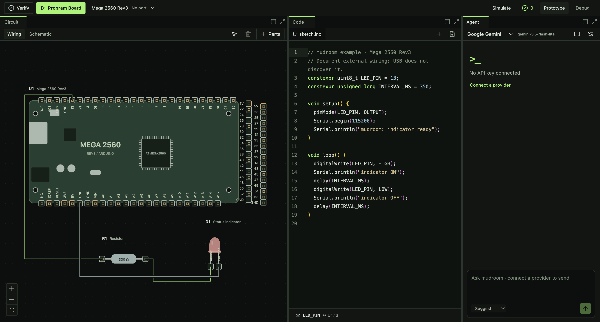

# mudroom

A local macOS workbench for developing documented hardware and firmware together. Editable wiring, a real code editor, scoped engineering checks, and an AI agent share one versioned project model.

Initial boards: **Arduino Mega 2560 Rev3** and **Espressif ESP32-S3-DevKitC-1 v1.1**. The catalog also includes generic LED/resistor/potentiometer, BB830, a photo-matched AS5600 module, generic SG90 and bare ITR9608. There are also 24 supporting power, interface, passive, sensor, logic and driver packages; see [catalog scope](docs/catalog.md). Existing exact passive packages are preserved for old projects. Pin facts link to original manufacturer evidence.



## Run

Requires **macOS** and **Node.js ≥22.12.0** (`.nvmrc` selects Node 22). Xcode command-line tools are needed for local toolchain/simulator setup. No API key or physical board is needed to launch or use the manual editor.

```sh
npm ci
npm run build
npm start
```

Development: `npm run dev`. Browser-only manual editor: `npm run dev:web`. Native app: `npm run package` creates `release/mudroom-darwin-arm64/mudroom.app` on this Mac. It is a local development bundle; nothing is published.

Compilation requires macOS, Arduino CLI and the `arduino:avr` / `esp32:esp32` cores in the standard Arduino15 data directory. Fresh-machine setup is below; these external tools are not included in `npm ci`. Build/simulator processes use file/network confinement and private scratch directories; existing user libraries are not implicitly exposed. Run `npm run setup:libraries` for the checksum-pinned official Servo 1.3.0 dependency. For Mega execution, run `npm run setup:simavr` once before packaging. It builds an external, pinned GPL simulator locally; source and license are retained under ignored `artifacts/tools` and included with the local app bundle. See [execution setup and scope](docs/execution.md).

### Firmware tools (optional for editing)

Install Xcode command-line tools if missing (`xcode-select --install`), then install [Arduino CLI](https://docs.arduino.cc/arduino-cli/installation/), for example with Homebrew:

```sh
brew install arduino-cli
arduino-cli core update-index --additional-urls https://espressif.github.io/arduino-esp32/package_esp32_index.json
arduino-cli core install arduino:avr@1.8.8
arduino-cli core install esp32:esp32@3.3.11 --additional-urls https://espressif.github.io/arduino-esp32/package_esp32_index.json
npm run setup:libraries
npm run setup:simavr
```

The verified development toolchain is Arduino CLI 1.5.1, AVR 1.8.8, ESP32 3.3.11 and Servo 1.3.0. Core installation follows the [official CLI interface](https://docs.arduino.cc/arduino-cli/getting-started/). Keep the standard macOS Arduino15 data directory: the compiler intentionally cannot read arbitrary user library paths. If a tool/dependency is missing, the app reports it; editing remains available. See [execution](docs/execution.md) for confinement, dependencies and exact scope.

## Try the loop

1. Prototype → inspect a Mega terminal; Evidence stays on demand.
2. Disconnect the signal wire, then drag **U1.12 → R1.1**. The initial code/binding still points to 13.
3. Open Issues and Output. Review/apply the coordinated fix; undo/redo through Edit.
4. Verify checks and compiles. Simulate executes Mega machine code separately.
5. Select a real device, Program Board, and review/approve the exact artifact. Real-device tests remain pending; no physical operation is automatic.
6. In Debug, explicitly start monitoring, inspect raw output and preview a field mapping. Unreported values are not zero. Workspace changes and samples cause zero model requests.
7. File → Save/Open preserves versioned source, circuit, layouts, properties, board configuration and mappings.

AI is optional. In AI settings, save a provider API key, select a model ID, and Test. Gemini is the primary live-tested provider; OpenAI, Claude and Grok have separate real protocol adapters checked with fixtures, without equivalent live acceptance. Keys stay encrypted in the desktop credential boundary. Provider model/account access can vary; there is no silent fallback. [Demo outline](docs/demo.md) distinguishes live verification from fixture tests.

## Verify

```sh
npm run check
npm run test:e2e
npm run test:toolchain
```

End-to-end tests run the actual Electron app in isolated temporary profiles. A provider fixture scenario exercises IPC, streaming, tools, proposals and key isolation without calling a real API. `test:toolchain` compiles both requested boards and runs the Mega example with local tools. Screenshots/results are ignored by Git. `npm run format` formats the source.

## Scope

Manual editing and checks work offline. Rules validate structural references, known supply shorts, mixed logic, explicit pin mappings and a simple LED path. They do not certify arbitrary circuits or analyze general C++ control flow. The schematic is a basic electrical-symbol view with independent layout. ESP32-S3 compilation uses conservative default toolchain options; confirm the actual flash/PSRAM variant before physical operations. Real-device upload/serial validation, ESP32-S3 simulation, analog/SPICE, advanced schematic tooling and datasheet import remain deferred.

Read [current status](docs/status.md), [product](docs/product.md), [architecture](docs/architecture.md), and [design](docs/design.md). Contributor rules and commands live in [AGENTS.md](AGENTS.md).

Agent instructions live in [src/services/instructions.ts](src/services/instructions.ts). Settings → Task limits exposes the independent task thresholds; the default reported-token maximum is 1,000,000. Gemini defaults to `gemini-3.5-flash-lite`. See [evaluation evidence and commands](docs/evaluation.md) before interpreting fixture results as live capability. `npm run evaluate:fixtures` exercises the same runtime with deterministic responses and real compilation; `npm run evaluate:gemini -- --cases led,servo-encoder --repeat 1` is an opt-in paid isolated batch. No physical actions are allowed by that suite.

Project → Servo and Encoder Example opens a complete labeled manual design with external servo power and Adafruit 757 level conversion. Verify compiles its exact visible source; Debug fields remain Not reported until actual firmware data arrives. Local review batches and structured questions continue the same task automatically. New chat clears conversation only; New Project clears the project/session. The recorded live Gemini LED task passed all eleven artifact checks and compiled/executed Mega machine code. A complete live servo/encoder creation pass remains unverified; that manual template is not presented as live AI success. See [evaluation evidence](docs/evaluation.md) for retained failures as well as passes.

The near-black/green theme uses the original system UI and code fonts, with no font installation or runtime download. Existing `.trace.json` projects and the original local settings/provider profile remain compatible with the mudroom rename.

## Repository verification

The [macOS workflow](.github/workflows/verify.yml) installs the lockfile, typechecks/tests and builds without API keys or hardware. Arduino/compiler, desktop and packaged-app checks are separate local commands above and in [AGENTS.md](AGENTS.md). Generated dependencies, build bundles, private settings, media and evaluation output are excluded from Git. The packaged app retains installed runtime dependency licenses/notices and a version manifest, plus the optional simulator's corresponding source and license.
